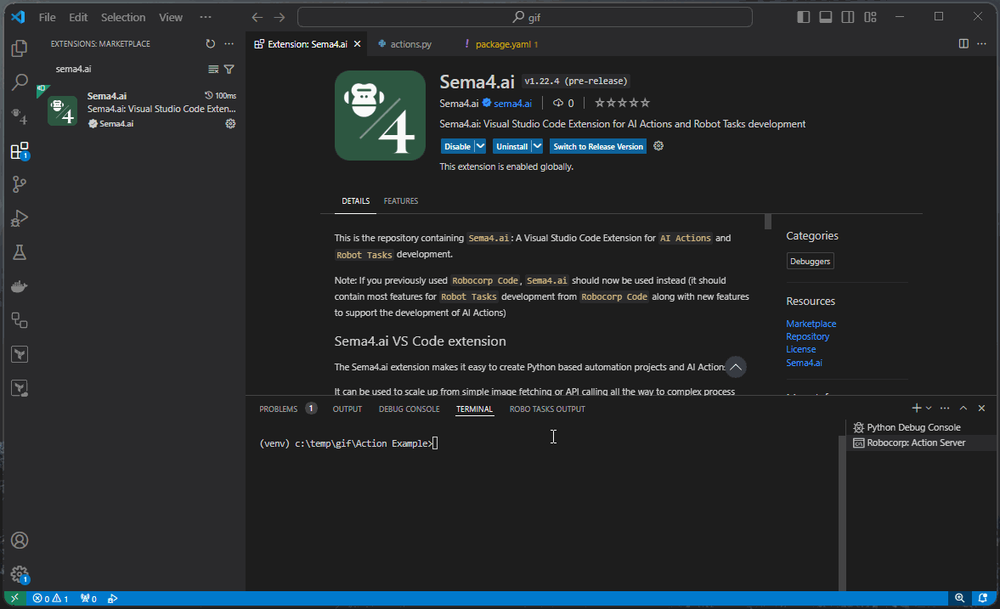

## Sema4.ai VS Code extension

> Note: The `Sema4.ai` extension from VS Code replaces the [Robocorp Code](https://marketplace.visualstudio.com/items?itemName=robocorp.robocorp-code) -extension. The same features exist in this extension, so you can just switch to using `Sema4.ai`. Future development will be focused here.

The Sema4.ai extension makes it easy to create Python based automation projects (Task Packages).

It can be used to scale up from simple image fetching or API calling all the way to complex process enterprise automation workflows.

Main features include:

-   **Automatic configuration of dependencies** - Every Python oriented project uses its own lightweight virtual environment and runs in isolation.

-   **Inspector for Web, Windows Application Elements & more** - Pick elements from different mediums and create locators for automation

-   **Create, run and debug projects** - Do these with ease while developing Tasks to automate applications

-   **Deploy projects to Control Room** - Run unattended automation in a safe, reliable and easy to use Cloud Platform.

> Note: the use of cloud-based orchestration in [Control Room](https://sema4.ai/docs/manage-agents/meet-control-room) requires an account.

### Get Started

1. Download [Sema4.ai extension for VS Code](https://marketplace.visualstudio.com/items?itemName=sema4ai.sema4ai), and open it in VS Code.

2. Open the command palette - (Windows, Linux): `CTRL-SHIFT-P` (macOS): `CMD-SHIFT-P`

3. Select the command `Sema4.ai: Create Task Package`

4. Open the sidebar and start running your tasks.

Full instructions are available at our [documentation site](https://sema4.ai/docs/automation/visual-studio-code) for the VS Code Extension.

This is under active development, so please [contact us](https://sema4.ai/contact-us/) for issues and feature requests.

### Agent and Action Packages (legacy agent platform)

Version 3 of the extension no longer supports Agent and Action Packages. To keep working with them, install version 2.x of the extension: see [Installing the Sema4.ai SDK (legacy agent platform)](https://sema4.ai/docs/build-agents/develop-actions/install-development-tools#sema4ai-vs-code-extension).

### Requirements

Supported operating systems: Windows (x64), Linux (x64) or macOS on Apple Silicon (arm64). macOS on Intel (x64) is not supported.

### Configuration

During the first activation, the extension will download additional dependencies that are required for it to run.

### Developing

See: [Developing](https://github.com/Sema4AI/vscode-extension/docs/develop.md) for details on how to develop the `Sema4.ai` -extension.

### Changelog

See: [Changelog](https://github.com/Sema4AI/vscode-extension/docs/changelog.md) for details on how to develop the `Sema4.ai` -extension.

### Reporting Issues

Issues may be reported in the [GitHub Issues](https://github.com/Sema4AI/vscode-extension/issues/new/choose).

Contact us via Slack: [sema4ai-users.slack.com](https://sema4ai-users.slack.com/ssb/redirect)

## License: Apache 2.0
